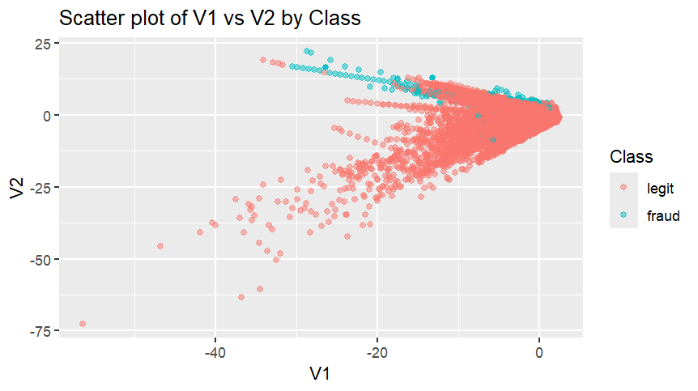
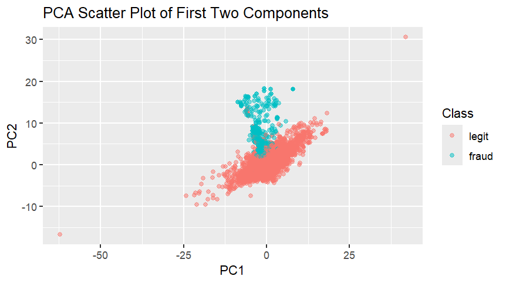

# Credit Card Fraud - Exploratory Data Analysis in R

An individual data analysis project by **Jaouher Chouchane**, Information Technology major and Business Analytics minor at Tunis Business School.

This portfolio project explores an extremely imbalanced credit-card transaction dataset using **descriptive statistics, stratified sampling, statistical comparison, and principal component visualizations**. It is based on my BA 340 Data Analysis coursework.

> **Scope:** This is **exploratory data analysis (EDA)**. No fraud-detection classifier, predictive model, classification accuracy, or AI system was trained or evaluated in this project.

## Project highlights

- Explore the proportion of legitimate and fraudulent transactions.
- Compare transaction-amount distributions using means, medians, standard deviations and a **Welch two-sample t-test**.
- Demonstrate a reproducible **stratified 70/30 split** (not used for model evaluation).
- Visualize the provided anonymized PCA features `V1` and `V2`.
- Apply a **secondary PCA** for teaching and visualization only; `V1`-`V28` are already PCA features.
- Generate reproducible PNG plots and CSV summaries from the source dataset.

## Project visualizations

The figures illustrate patterns in anonymized features and a secondary PCA projection. The analysis script generates additional figures and summary tables in `outputs/` when the dataset is supplied.





## Dataset

Source: [Credit Card Fraud Detection - Machine Learning Group, ULB (Kaggle)](https://www.kaggle.com/datasets/mlg-ulb/creditcardfraud).

The source describes **284,807 transactions**, including **492 fraud cases (approximately 0.172%)**. Columns `V1`-`V28` were already transformed with PCA to protect confidentiality; `Time` is elapsed seconds from the first transaction, not a timestamp or clock hour.

The `creditcard.csv` dataset is **not included** in this repository because it is a large third-party dataset. Download it from the source and put it in `data/creditcard.csv`. Do not commit transaction records to GitHub.

## Run the analysis

Requirements: R 4.2+ and two packages: `data.table`, `ggplot2`.

From the repository root, open R and install the packages once:

```r
install.packages(c("data.table", "ggplot2"))
```

Run the script from a terminal:

```bash
Rscript analysis/analysis.R data/creditcard.csv outputs
```

Alternatively, open `analysis/analysis.R` in RStudio and execute it with the repository root as your working directory.

The script validates the required data fields, then writes:

| Output | Description |
| --- | --- |
| `outputs/class_summary.csv` | Counts, shares and amount statistics by class |
| `outputs/amount_test.csv` | Welch t-test statistic, confidence interval and p-value |
| `outputs/stratified_split.csv` | Class counts after a reproducible 70/30 split |
| `outputs/secondary_pca_variance.csv` | Variance explained by the secondary PCA |
| `outputs/figures/*.png` | Class balance, V1/V2, secondary PCA, amount distribution |

## Repository layout

```text
credit-card-fraud-eda/
├── analysis/analysis.R           # Reproducible analysis script
├── data/README.md               # Dataset download instructions; CSV excluded
├── docs/report.pdf              # Project report
├── docs/report.tex              # Editable LaTeX source
├── figures/                    # Exploratory visualizations
└── README.md
```

## Interpretation and limitations

- The dataset is strongly imbalanced; classification accuracy would be misleading if a classifier were introduced without careful evaluation.
- A mean-comparison test does **not** demonstrate that an effective fraud detector exists. Amounts are skewed and extreme values can affect means.
- The dataset's `Time` column is **relative elapsed time**. The derived modulo-24 hour bucket is not a true time-of-day feature.
- The secondary PCA is a re-projection of already PCA-transformed features, not new information about the confidential original variables.
- The script calculates dataset-dependent statistics when run with `creditcard.csv`; unverified test results are not reported.

## Reproducibility

The repository does not include `creditcard.csv` or precomputed statistical test results. Run the R script with the source dataset to generate the quantitative tables and figures before making statistical claims.

## Potential next steps

To extend this into a machine-learning project, train a classifier on the training split and evaluate it on the held-out test set using metrics appropriate to rare-event detection, such as **area under the precision-recall curve (AUPRC)**. This has not yet been implemented here.

